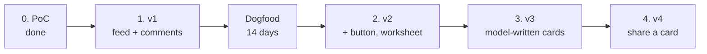

# LifeKit Roadmap

This file explains where LifeKit is going and **why**. Each stage lists what
the user gets. Each decision lists what we chose, why, what we gave up, and
when to look at it again.

- The vision and the rules are in [`.agents/intent.md`](../../.agents/intent.md).
- The work items (slices) and their status are in [`KANBAN.md`](KANBAN.md).
- The assumptions with IDs are in [`ASSUMPTIONS.md`](ASSUMPTIONS.md).

Last revised 2026-11-27: the feed-and-comments decision (D1–D10 below).

## The stages at a glance



| Stage | What the user gets | Status |
|-------|--------------------|--------|
| 0. PoC | A pipeline that pulls exercises and ideas out of a PDF, coach tools, scheduling, and a first feed and chat. | Done 2026-10 |
| 1. v1 | One book as a feed of cards. A comment thread under each card. The coach replies to every comment. Like and dislike on cards and on coach replies. | **Current** |
| Dogfood | Daily real use of v1. Nothing new is designed until it ends. | Next |
| 2. v2 | A "+" button to post a journal entry or check-in that is not tied to a card. A worksheet card type with a small form. | After dogfood |
| 3. v3 | The model writes the card layout itself, in OpenUI, so a card can hold richer content such as an animation. | Later |
| 4. v4 | Share a card, with its quote and your thread, to an external chat app such as ChatGPT. | Later |

## v1 in one picture

The app is one column of cards. The phone and the desktop look the same.

```text
┌──────────────────────────────────────────┐
│ Designing Your Life            142 cards │  header
├──────────────────────────────────────────┤
│ Practice · From the book                 │  card (OpenUI)
│ Write your Workview                      │
│ Why: know what work means to you.        │
│  1. Set a 30-minute timer.               │
│  2. Write about 250 words on ...         │
│ “Write a short reflection on ...” p. 41  │
│                                          │
│ 👍  👎                       3 comments  │  reactions (code)
│ ──────────────────────────────────────── │
│ View all 3 comments                      │  thread
│ You: Did it. Work is a way to ...        │
│ Coach: You wrote “a way to grow”. ...    │
│ ┌──────────────────────────────────────┐ │
│ │ How did it go?                       │ │  comment box
│ └──────────────────────────────────────┘ │
└──────────────────────────────────────────┘
```

### What a comment means on each card type

| Card type | What the card shows | What the user's comment is | Comment box hint |
|-----------|--------------------|-----------------------------|------------------|
| insight | An idea, rule, pitfall, or term, why it matters, and the quote | A thought or a question for the coach | "What do you make of this?" |
| practice | An exercise: its purpose, its steps, and the quote | Notes or results ("Did step 2 today…") | "How did it go?" |
| habit | A behavior to repeat, how often, and how to start | A check-in | "How did it go today?" |
| reflect | A journal prompt and up to 3 follow-up prompts | The journal entry | "Write your entry…" |
| question | A self-check question. The author's answer appears after the user's first comment. | The user's answer | "Your answer…" |

### v1 slices

| # | Slice | Proposal |
|---|-------|----------|
| 0 | Feed-only UI: remove the sidebar, the chat pages, the journal page, and the free-chat API | `openspec/changes/feed-only-ui/` |
| 1 | Card types: the five types, their fields, and what a comment means on each | `openspec/changes/card-types-v1/` |
| 2 | Book model: PDF and EPUB become sections and passages; `lifekit ingest` | `openspec/changes/book-model-v1/` |
| 3 | Item extraction: typed, grounded, de-duplicated items with a usefulness check | `openspec/changes/item-extraction-v2/` |
| 4 | Card generation: items become stored cards with stable ids and code-built OpenUI | `openspec/changes/card-generation/` |
| 5 | Feed: the cards in reading order, reactions, and "start where you left off" | `openspec/changes/feed-v1/` |
| 6 | Card comments: a thread per card, coach replies, reactions on replies | `openspec/changes/card-comments/` |

Slice 0 comes first, so every later slice builds on a feed-only layout.
Slices 1 and 2 can then run in parallel. Each later slice needs the one
before it. From slice 0 until slice 6, the app has no way to talk to the
coach. That gap is accepted for one dogfood user.

## Decisions and their reasons

Each decision has four parts:
- **Decision:** what we chose.
- **Why:** the reason.
- **Gave up:** the cost.
- **Revisit when:** the signal to look at it again.

### D1. The feed is the only screen

- **Decision:** v1 has one screen, the feed. There is no side drawer, no
  sidebar, no tabs, and no separate chat page.
- **Why:**
  - While the user works on a card, they need that card. They do not need the
    other cards. NN/g says side sheets help when users need to "refer to the
    main, background information". In LifeKit, that information is the card
    itself.
  - A comment thread sits right under its card, so the card stays in view.
  - One column works the same on a phone and on a desktop. No second layout is
    needed for small screens.
- **Gave up:**
  - A workspace with checklists, forms, and scales for each card type.
  - The drawer work on the `feat/card-first-feed` branch. That branch is
    abandoned, not merged.
- **Revisit when:** dogfood shows a card type that a comment cannot serve.

### D2. A comment is the only way to act on a card

- **Decision:**
  - The user acts on a card only by writing a comment (A32). A journal entry, a
    habit check-in, a note on an exercise, and an answer to a question are all
    comments.
  - The table "What a comment means on each card type" above shows each case.
- **Why:**
  - The user learns one control.
  - Journaling is writing, and so is a check-in with a note.
  - One input path means less code and fewer states to test.
- **Gave up:**
  - Structured input: ticking steps one by one, or setting a scale.
  - The card "status" (new, opened, in progress, done) that the drawer design
    needed.
- **Revisit when:** v2 adds the worksheet form (D7).

### D3. The comment box takes markdown; no rich-text editor

- **Decision:** the comment box is a plain text box that grows as you type.
  Posted comments show as rendered markdown: bold, lists, and links.
- **Why:**
  - `react-markdown` and `remark-gfm` are already in `frontend/package.json`.
    The chat already uses them. So this needs no new dependency.
  - A plain text box behaves well with phone keyboards.
- **Gave up:** formatting buttons, and seeing the formatting while you type.
- **Revisit when:** dogfood shows the user wants formatting buttons.

### D4. The coach replies to every comment

- **Decision:**
  - Every comment gets a coach reply. The reply fits the comment (A33).
  - A journal entry gets a few warm words and at most one question.
  - A direct question gets a real answer.
  - The reply is grounded in the card, its passage, the user's thread, and
    passages found by search.
- **Why:**
  - A reply makes the user's effort feel seen.
  - One rule ("always reply") is simpler than buttons or an "@coach" trigger.
- **Gave up:**
  - Each comment costs one model call on the home GPU. The user waits while
    the reply streams in.
  - Some replies may feel like noise.
- **Revisit when:** more than 20% of coach replies get a dislike in dogfood.
  Then switch to "reply only when asked".
- **Later:** a reply that is only a reaction (the coach "likes" a journal entry
  without words) is v2. It needs a second output mode from the model.

### D5. Reactions: like and dislike

- **Decision:**
  - Every card and every coach reply has like and dislike (A34).
  - A disliked card folds into one line ("Marked not useful · Undo"). It
    leaves the feed on the next load.
  - No counts of reactions are shown.
- **Why:**
  - Dislike on a card replaces the old "Not useful" menu. It counts toward the
    dogfood exit check.
  - Dislike on a coach reply measures D4.
  - Like tells us which cards are worth keeping when we tune extraction.
- **Gave up:** finer feedback, for example "wrong" versus "boring".
- **Revisit when:** the dogfood review cannot tell why cards were disliked.

### D6. OpenUI for everything the app or the model shows

- **Decision:**
  - Cards and coach replies render through one OpenUI renderer.
  - In v1, **code** builds each card's OpenUI program from the card's content,
    at ingest time (A31).
  - In v3, the **model** writes the card program, which allows richer content
    such as animation.
  - What the user types stays the user's own markdown.
- **Why:**
  - One renderer for cards and replies means one look and one code path.
  - The stored card program is the seam for v3. v3 changes only who writes the
    program. The table, the API, and the renderer stay the same.
  - Code-built programs in v1 remove three risks:
    - The local 27B model may write invalid OpenUI, which the retired A27
      had to handle with a validator and rejections.
    - About 200–250 model calls per book.
  - The v1 card library is small, so a model-chosen layout would add little.
- **Gave up:** model-chosen layouts in v1.
- **Revisit when:** v3 starts, or dogfood shows cards that need a layout code
  cannot build.

### D7. Five card types in v1; worksheet waits for v2

- **Decision:**
  - v1 has five types: insight, practice, habit, reflect, and question.
  - A book "template" (a form or self-assessment) becomes a practice card. Its
    fields become the steps. The user answers them in one comment.
  - The worksheet type, with a real form, comes in v2 with the "+" button.
- **Why:**
  - OpenUI can draw a form, but a form is a second way to act next to the
    comment box.
  - A form also needs saved drafts. Those are the drawer problems that D1
    removes.
  - Mapping templates to practice keeps their content in v1 at no extra cost.
- **Gave up:** per-field answers you can read back one field at a time.
- **Revisit when:** v2. The v2 form should post its answers as one comment, so
  the thread stays the record.

### D8. Question cards show the author's answer after your first comment

- **Decision:**
  - A question card hides the author's answer until the user posts a comment.
  - Then the card shows the author's answer and the quote.
  - Nothing marks the user's answer as right or wrong.
- **Why:**
  - Writing an answer first is the self-check.
  - Showing the author's answer is all the feedback LifeKit gives
    (intent.md: no scores).
- **Gave up:** nothing new.
- **Revisit when:** never for scoring. The rule against scores is permanent.

### D9. No "done". The feed starts where you left off

- **Decision:**
  - Cards do not have a done state (A29).
  - The feed is the book's cards in reading order, minus disliked cards.
  - On load, the feed starts at the last card you liked, disliked, or
    commented on. A "Show earlier cards" button loads the cards above it.
- **Why:**
  - With comments as the only action, nothing marks a card done.
  - Without a start point, every visit would begin at card 1 of about 200.
  - "The last card you responded to" uses data we already store. It needs no
    tracking of what you scrolled past.
- **Gave up:**
  - A feed that gets shorter as you finish cards.
  - Cards you skipped without a response sit above the start point.
- **Revisit when:** the feed feels too long in dogfood. That is also the
  trigger for spaced repetition (Parked).

### D10. Free chat is retired

- **Decision:**
  - v1 removes the chat pages (`/chat`, `/c/<id>`), the free-chat composer,
    the sidebar with recent conversations, and the `/journal` placeholder.
    Slice 0 (`feed-only-ui`) does this first.
  - Old conversations stay in the database. Nothing reads them.
- **Why:**
  - Two ways to talk to the coach split the user's history.
  - Every coach talk is now tied to a card, so it stays grounded and easy to
    find again.
- **Gave up:** asking the coach about the book without a card. v4 sharing gives
  a way to take a card's context to a general chat app.
- **Revisit when:** dogfood shows questions that fit no card. The v2 "+" post
  may cover them.

### D11. Cards are made once, offline, with stable ids

- **Decision:**
  - The pipeline makes the cards at ingest time and stores them.
  - A card id is a UUIDv5 of the book, the card type, and the normalized quote.
  - A card that a re-run no longer makes is retired, not deleted.
- **Why:**
  - Nothing is generated while you scroll.
  - Re-running the pipeline keeps your comments and reactions on the same
    cards.
- **Gave up:** fixing a card's wording without a pipeline run.
- **Revisit when:** quote edits across re-runs leave comments on retired cards
  (A28).

### D12. One book in v1

- **Decision:** the feed shows one book. The data model already supports many.
- **Why:** prove that the cards are useful on one book before mixing books.
- **Gave up:** a feed across the shelf.
- **Revisit when:** dogfood passes. See Parked.

### D13. The "+" button for posts without a card is v2

- **Decision:** v2 adds a "+" button. With it, the user can post a journal
  entry or a check-in that does not belong to any card.
- **Why later:**
  - A post with no card needs its own place in the feed.
  - It also needs coach grounding with no card.
  - v1 first proves that comments on cards are enough for daily use.
- **Revisit when:** v2 planning, after dogfood.

### D14. Sharing a card to an external chat app is v4

- **Decision:** v4 lets the user send a card, its quote, its passage, and the
  user's thread to an external chat app such as ChatGPT.
- **Why:**
  - It replaces free chat for open questions.
  - The user can use a bigger model when they want one.
- **Watch out:**
  - This is the one place where data leaves the machine.
  - It must be an explicit action that shows exactly what will be sent
    (intent.md: local-first).
  - The format (a markdown bundle through the share sheet or the clipboard) is
    decided in v4.
- **Revisit when:** v4 planning.

### D15. Design rules borrowed from Meta's Astryx conventions

- **Decision:**
  - We borrow the written design rules of Astryx (`meta/astryx`, MIT, beta),
    not the component library.
  - The rules:
    - Nested corner radii follow inner = outer − gap.
    - Choose a hairline border or a soft shadow, not both.
    - No accent stripe on the side of a card.
    - One primary action per surface.
    - A status always pairs color with an icon.
    - Contrast meets AA in light and dark themes, through `light-dark()` pairs.
    - Small changes animate in about 175 ms, and entrances and exits in about
      410 ms.
    - Animate only transform and opacity, and respect reduced motion.
- **Why:**
  - The user wants an app that is beautiful enough to return to.
  - These rules fit our existing `--lk-*` tokens with no new dependency.
- **Gave up:** Astryx's ready-made components. Installing it would add StyleX
  and a beta dependency.
- **Revisit when:** v3, when cards get richer components.

## Dogfood exit check

Proposed. **This needs the human's approval.**

- The user opens the feed on at least 10 of 14 days.
- At most 20% of the cards the user reacted to get a dislike.
- At most 20% of coach replies get a dislike (D4).
- Item extraction reaches at least 80% precision on the golden set
  (`item-extraction-v2/`).

## Parked

"Parked" means "not designed until dogfood ends". Each item has a reason.

| Item | Why it waits |
|------|--------------|
| Spaced repetition and daily selection | The feed shows every useful card first. The FSRS code stays, but the feed does not read it. |
| Tags and semantic search | One book does not need search. Search needs embeddings. |
| Long-term user memory | Each card's thread is the only memory in v1. |
| Multi-book feed | Prove one book first (D12). |
| Program layer (coaching sessions, momentum, interviewer, invite to coach) | Comes after the core loop works. |
| Notifications and nudges | Comes after the core loop works. |
| Knowledge graph or concept layer | No v1 feature reads a graph. |
| Better retrieval (hybrid search, rerank) | Passages from the book model are the base. Tune after dogfood. |
| A public book format or export | SQLite is the only source of truth. An export is a view; add it when a consumer exists. |
| Removing the old content tables (`exercises`, `key_ideas`, `fsrs_cards`, `completions`, `idea_signals`) | Frozen in v1 with no readers. A cleanup slice decides after v1. |

## Retired ideas

These ideas were planned and then dropped. Keep them in mind so they do not
come back by accident.

| Idea | Retired | Why |
|------|---------|-----|
| Side drawer with a surface per card type | 2026-11-27 | D1 and D2: comments under the card do the job. |
| Card status (new, opened, in progress, done) and done buttons | 2026-11-27 | D9: comments and reactions replace it. |
| Model-written card and surface programs in v1, with an ingest validator | 2026-11-27 | D6: code builds v1 cards; the model writes them in v3. |
| "Not useful" menu | 2026-11-27 | D5: the dislike reaction replaces it. |
| Free chat, the sidebar, and the journal page | 2026-11-27 | D10. |
| Daily briefing (one exercise, one resurfaced idea, fading ideas) | 2026-11-27 | It showed the same front-matter ideas every day. The card feed replaces it. |
