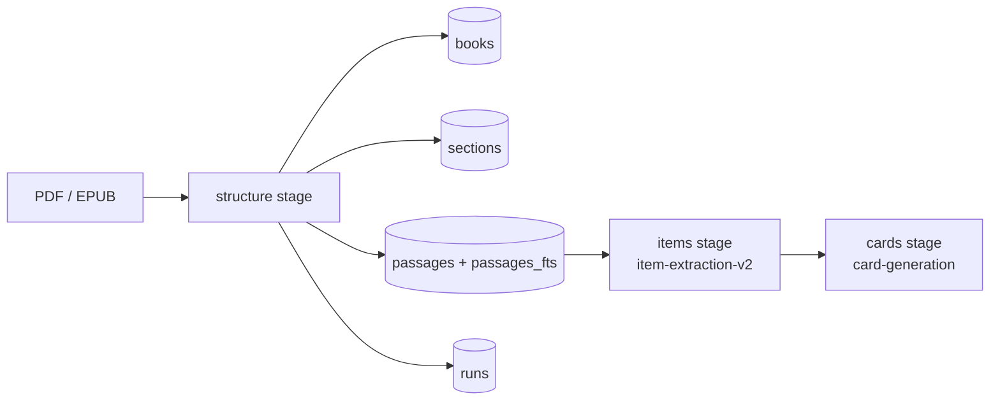

# Design — book-model-v1

## Context

See proposal.md → Why. Relevant current code:

- `lifekit/store/chapter_splitter.py`: `fitz.open()`, `_page_texts()` (plain
  `page.get_text()` per page), `_check_text_layer()`, `_chapters_from_toc()`
  (top TOC level only), `_chapters_from_headings()`, `_chapters_fixed_size()`.
- `lifekit/books/registry.py`: `book_id_for()` = sha256 of the path string.
- `lifekit/db/schema.py`: one `SCHEMA` string of `CREATE TABLE IF NOT EXISTS`
  plus small in-place migrations (`_migrate_validation_log_nullable_passed`).
- Known issue D10: the external-content FTS5 delete trigger on `book_chunks`
  fails on this machine's SQLite.

The AKBF brainstorm proposed three layers. This change builds layer 1 (source,
deterministic). Layer 2 (items) is item-extraction-v2; layer 3 (cards and
indexes) is card-generation and later work.



## Goals / Non-Goals

**Goals:**
- Stable passage ids that later rows can reference.
- Front and back matter never reach extraction.
- One command for the whole pipeline.

**Non-Goals:**
- No JSON-LD, RDF, or W3C Web Annotation export (parked in KANBAN).
- No OCR, no audio, no web pages.
- No Docling. It parses PDF and EPUB into a rich tree, but it is a heavy
  dependency and PyMuPDF already gives TOC, blocks, and pages.
- No embeddings (parked with semantic search).

## Decisions

### D1. Read text as PyMuPDF blocks, not plain page text

`page.get_text("blocks")` returns `(x0, y0, x1, y1, text, block_no,
block_type)`. A block is close to a paragraph, and its position lets us drop
headers and footers. Plain `get_text()` loses both. Keep `clean_and_sanitize`
from the current splitter on each block. Join lines inside a block with a
space, and join a word broken by a hyphen at a line end ("de-\nsign" →
"design").

### D2. Section boundaries from all TOC levels

1. Read `doc.get_toc()` → `[level, title, page]`. Drop entries with an empty
   title or a page outside the book.
2. For each entry, find its start block: the first block on its page whose
   whitespace-normalized, lowercased text starts with the first 40 characters
   of the normalized title. If none matches, start at the page's first block.
3. A section's own text runs from its start block up to (not including) the
   next entry's start block, at any level. Drop the heading block itself.
4. Parent index = the nearest earlier entry with a smaller level.
5. If the TOC is unusable (fewer than 2 entries), reuse
   `_chapters_from_headings` and then `_chapters_fixed_size` from the current
   splitter, as depth-1 sections.

Expose the reusable readers from `chapter_splitter.py` instead of copying them.

### D3. Section kinds from a TOML title list

`lifekit/books/section_kinds.toml`:

```toml
front = ["cover", "title page", "copyright", "dedication", "contents",
         "table of contents", "epigraph", "praise for", "also by"]
back  = ["notes", "endnotes", "acknowledgments", "acknowledgements", "index",
         "bibliography", "references", "about the author", "about the authors",
         "credits", "permissions"]
```

A title matches when its normalized form (lowercase, digits and punctuation
removed) equals or starts with a list entry. "Introduction", "Preface",
"Foreword", and "Conclusion" stay `body` on purpose: in the dogfood book the
Introduction gave 88 ideas and the Conclusion 23 exercises.

User corrections live in `section_kind_overrides(book_id, title_key, kind)`,
keyed by the normalized title, so they apply again after re-ingest even if
indexes move.

### D4. Passage building

Walk the section's blocks in order:
- A block shorter than 120 characters that does not end in `. ? ! : ” "` joins
  the next block (headings, captions, broken lines).
- A block longer than 2500 characters splits at the sentence end nearest to
  1500 characters, repeatedly.
- Section text = passages joined by `"\n\n"`. Offsets are computed while
  joining, so "offsets point into the section" holds by construction.

Passage id = `f"{book_id}:{section_idx}:{n}"`. It is stable because the walk is
deterministic for the same file and settings.

### D5. Furniture filter

Per page, a block is a header or footer candidate when its `y1` is in the top
7% or its `y0` is in the bottom 7% of the page height. Normalize the text by
removing digits and whitespace. Drop the block when its normalized text occurs
on at least 30% of pages (minimum 3 pages), or when the text is only digits or
roman numerals. Reflowed EPUB pages seldom have furniture, so the filter does
nothing there.

### D6. Tables

```sql
ALTER TABLE books ADD COLUMN format TEXT;          -- 'pdf' | 'epub'
ALTER TABLE books ADD COLUMN content_hash TEXT;    -- full sha256 of the bytes

CREATE TABLE IF NOT EXISTS sections (
    book_id TEXT NOT NULL REFERENCES books(id),
    idx INTEGER NOT NULL,             -- reading order, 0-based
    parent_idx INTEGER,
    depth INTEGER NOT NULL,           -- 1 = top level
    title TEXT NOT NULL,
    kind TEXT NOT NULL CHECK(kind IN ('front','body','back')),
    page_start INTEGER NOT NULL,
    page_end INTEGER NOT NULL,
    text TEXT NOT NULL,
    PRIMARY KEY (book_id, idx)
);
CREATE TABLE IF NOT EXISTS passages (
    id TEXT PRIMARY KEY,              -- '<book_id>:<section_idx>:<n>'
    book_id TEXT NOT NULL REFERENCES books(id),
    section_idx INTEGER NOT NULL,
    idx INTEGER NOT NULL,
    text TEXT NOT NULL,
    char_start INTEGER NOT NULL,
    char_end INTEGER NOT NULL,
    page INTEGER NOT NULL,
    UNIQUE (book_id, section_idx, idx)
);
CREATE VIRTUAL TABLE IF NOT EXISTS passages_fts USING fts5(
    text, book_id UNINDEXED, passage_id UNINDEXED
);
CREATE TABLE IF NOT EXISTS section_kind_overrides (
    book_id TEXT NOT NULL, title_key TEXT NOT NULL,
    kind TEXT NOT NULL CHECK(kind IN ('front','body','back')),
    PRIMARY KEY (book_id, title_key)
);
CREATE TABLE IF NOT EXISTS runs (
    id TEXT PRIMARY KEY,              -- uuid4 hex
    book_id TEXT NOT NULL,
    stage TEXT NOT NULL,
    model TEXT, prompt_hash TEXT,
    params TEXT NOT NULL DEFAULT '{}',   -- JSON
    status TEXT NOT NULL CHECK(status IN ('running','ok','failed')),
    stats TEXT NOT NULL DEFAULT '{}',    -- JSON counts
    error TEXT,
    started_at TIMESTAMP DEFAULT CURRENT_TIMESTAMP,
    finished_at TIMESTAMP
);
```

`passages_fts` is a normal FTS5 table with its own copy of the text, not an
external-content table. Re-ingest runs `DELETE FROM passages_fts WHERE book_id
= ?`, which needs no FTS5 `'delete'` command, so known issue D10 cannot hit it.
The copy doubles passage text on disk; one book is about 1 MB, which is fine.

The `ALTER TABLE` lines run in a migration function that checks
`PRAGMA table_info(books)` first, following the existing migration pattern.

Re-ingest replaces a book's `sections`, `passages`, and `passages_fts` rows in
one transaction. It does not delete items or cards; later stages re-anchor or
retire them (see item-extraction-v2 and card-generation).

### D7. Book id from file bytes

`book_id = sha256(bytes)[:16]`, unless `--book-id` is given. The full hash goes
into `books.content_hash`. When a new file arrives with an explicit id that
already exists, the book row is updated (path, hash, format). This replaces
`book_id_for()` for the new path; `register_book()` stays for the frozen old
path. Alternative: resolve the path before hashing (the P5 suggestion).
Rejected: moving or renaming the file would still change the id.

### D8. Stage runner

`lifekit/ingest.py` holds a `Stage` protocol (`name`, `run(ctx) -> dict of
counts`) and an ordered `STAGES` list. This change registers `StructureStage`.
item-extraction-v2 and card-generation append theirs. `Pipeline.run(ctx,
from_stage)` wraps each stage in a run record (`lifekit/runs.py`:
`start_run()`, `finish_run()`, `fail_run()`), stops on the first failure, and
returns the summaries. A missing stage name in `STAGES` (for example before
item-extraction-v2 lands) prints "items: not built yet — skipped".

Alternative: a Makefile chain of the existing `python -m` entry points.
Rejected: no run records, no re-run from a stage, and Makefile logic is outside
the "Python first" rule.

## Risks / Trade-offs

- [TOC titles differ from the printed heading, so the start block is not found]
  → Fall back to the page's first block. The section then holds a few extra
  lines from the previous section. Visible in `lifekit book sections`.
- [EPUB "pages" are reflowed, so page numbers mean little] → Page is kept for
  PDF citations only; EPUB grounding uses passage ids.
- [The 120-character join rule merges a real one-line paragraph with the next]
  → Harmless for grounding; quotes still match inside the bigger passage.
- [Changing the passage rules later changes passage ids] → Cards key on the
  quote, not the passage id (card-generation D3), so user work survives.

## Migration Plan

1. Ship the new tables; old tables stay untouched.
2. Re-ingest the dogfood book from its PDF on the home workstation:
   `lifekit ingest <path-to-dyl.pdf> --book-id dyl`. The structure stage needs
   no model, so it can also run on the VM.
3. Rollback: the new tables are additive; drop them to roll back.

## Open Questions

- Location of the dogfood PDF on the workstation. Any copy works because the id
  is given with `--book-id`.
