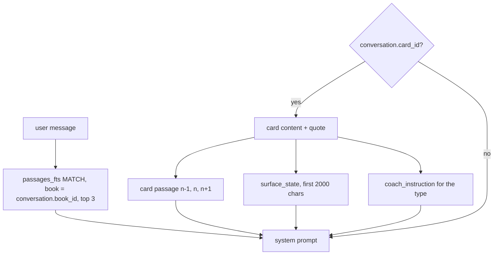
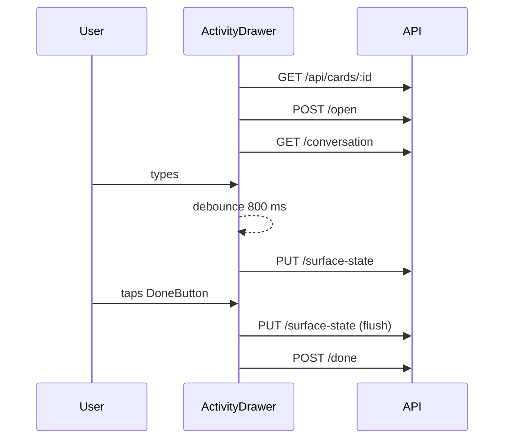

# Design — card-activity-drawer

## Context

- feed-v1 gives `card_state(card_id, status, prev_status, updated_at)`,
  `card_events`, `lifekit/serve/feed.py`, and an `ActivityDrawer` that renders
  `surface_ui` with the surface library and keeps `?card=<id>` in the URL.
- card-generation fixes the surface state keys: input values under their
  `name`, `steps` as a list of booleans, `revealed: true` after a reveal
  (card-types-v1 design, "surface-state keys").
- card-types-v1 gives `next_status(current, target, previous=None)` (raises
  `InvalidTransition`),
  `can_finish(type, content, surface_state) -> (ok, missing)`, and
  `spec(type).coach_instruction`.
- book-model-v1 gives `passages(id, book_id, section_idx, n, text)` and the
  plain FTS5 table `passages_fts(book_id UNINDEXED, passage_id UNINDEXED,
  text)`.
- OpenUI 1.2 `Renderer` props: `initialState` (restore), `onStateUpdate`
  (every change), `onAction` (custom actions and `ToAssistant`).
- Today `conversations` has `seed_kind IN ('card','composer')` and a free-form
  `seed_ref`. Old card conversations hold refs such as `exercise:3`.
- Today `post_message` calls `_coach_messages(c, app.config["book_id"], …)`, so
  every reply is grounded on the server's pinned book.

## Goals / Non-Goals

**Goals:**
- Nothing the user writes in a drawer is lost.
- The card's status follows what the user does, with no manual status UI
  (intent never-build: manual scheduling UI).
- The coach answers about this card, this book, and what the user wrote.

**Non-Goals:**
- No long-term user memory across cards (parked).
- No search or tags (parked).
- No journal page. `/journal` stays "Coming soon"; reflect entries live on
  their cards.

## Decisions

### D1. Schema migration

```sql
ALTER TABLE card_state ADD COLUMN surface_state TEXT;   -- JSON, ≤ 64 KB
ALTER TABLE conversations ADD COLUMN card_id TEXT;
CREATE UNIQUE INDEX IF NOT EXISTS conversations_card ON conversations(card_id);
```

Added as a `_migrate_*` function in `lifekit/db/schema.py`, guarded by a
`PRAGMA table_info` check like the existing migrations. SQLite allows many
NULLs in a unique index, so old conversations need no change.

Alternative: reuse `seed_ref` for the card id. Rejected: old rows already use
`seed_ref` for other refs, so a unique index on it would fail on real data.

### D2. Endpoints

| Method | Path | Body | Result |
|--------|------|------|--------|
| GET | `/api/cards/<id>` | – | `{id, book_id, type, title, card_ui, surface_ui, status, surface_state, retired}`; 404 if unknown |
| POST | `/api/cards/<id>/open` | – | `{status}` |
| PUT | `/api/cards/<id>/surface-state` | state JSON | `{status}`; 413 over 64 KB; 400 if not an object |
| POST | `/api/cards/<id>/done` | – | `{status: "done"}` or 409 `{missing: [labels]}` |
| POST | `/api/cards/<id>/checkin` | `{date: "YYYY-MM-DD"}` | `{checked_in: true, new: bool}` |
| GET | `/api/cards/<id>/conversation` | – | `{id}` |

`GET /api/cards/<id>` replaces feed-v1's `/surface` endpoint (one card lookup,
not two). The client sends the local date for check-ins, because the server
does not know the user's time zone; the server checks for an existing
`checkin` event with the same `payload.date` before it inserts.

Each route names its target status and calls `next_status(current, target)`:
open → `opened`, save → `in_progress`, done → `done`. Open and save catch
`InvalidTransition` and keep the current status, so a reopened `done` card
stays `done`. Done on a card that is already `done` returns 200 with no change.

`done` calls `can_finish(type, content, surface_state)`; when `ok` is false the
response lists the missing field labels, and the drawer shows "Fill in: …" or,
for a question, "Reveal the author's answer first".

### D3. Get-or-create conversation

```python
c.execute(
    "INSERT OR IGNORE INTO conversations (id, title, book_id, seed_kind, seed_ref, card_id)"
    " VALUES (?, ?, ?, 'card', ?, ?)",
    (uuid4().hex[:12], card.title, card.book_id, card.id, card.id),
)
row = c.execute("SELECT id FROM conversations WHERE card_id = ?", (card.id,)).fetchone()
```

The unique index makes the two-requests case safe without a lock. The title is
the card title, so the sidebar shows it, and the first-message retitle in
`post_message` is skipped when `card_id` is set.

### D4. Grounding

Move `_fts_query` and `_coach_messages` into `lifekit/serve/coach.py` and
rewrite the message builder:



System prompt order: OpenUI chat prompt; role line ("You are LifeKit's coach
for the book '<title>'. Use only the book text below. Do not interpret the
user's personality."); the type's `coach_instruction`; "The card:" with title,
content JSON, and quote; "The user's work so far:" with the state; "Book text:"
with the passages, each tagged `[<section title>]`, the card passages first and
search hits after, with duplicates removed. Then the history and the message.

The state goes in as `json.dumps(state, ensure_ascii=False)[:2000]`. For a
practice card, the `steps` booleans are turned into "done: step text" lines
first, so the model sees words instead of `[true, false]`.

When a card's `passage_id` no longer exists (re-ingest), the card quote alone
stands in for the passage block.

### D5. Drawer



- `initialState` = saved `surface_state`. `onStateUpdate` stores the latest
  state in a ref and restarts an 800 ms timer. Closing the drawer, switching
  cards, and the `done` action flush the timer first.
- `onAction`: `MarkDone` → flush, then `POST /done`; on 409 show the missing
  list inside the drawer. `CheckIn` → `POST /checkin` with the local date.
  `ToAssistant` (from `AskCoach`) → send the text through `useConversation` for
  the card's conversation.
- Layout: the surface on top; `ChatView` for the card's conversation below it,
  in one scroll area on phones and two stacked panes on desktop.
- A failed save shows "Not saved — retrying" and retries on the next change or
  on close; it does not drop the state.
- A done card leaves the feed list at once (feed-v1 `useFeed` gets a
  `remove(id)`), and the drawer stays open on it until the user closes it.

### D6. Removing the old grounding path

Delete `_retrieve_passages` and `_search_chapters`. Delete the
`python -m lifekit.store` ingest entry and the `book_chunks` writers in
`pdf_ingester.py` and `epub_ingester.py` if nothing else uses them (check with
`find_usages`). Point `make ingest` at `lifekit ingest` if book-model-v1 did not
already. Keep the `book_chunks` and `chapters` tables: dropping them buys
nothing for dogfood.

## Risks / Trade-offs

- [Lost typing on a crash in the 800 ms window] → Acceptable: at most a few
  words. The flush on close covers the normal path.
- [A 2000-character cap cuts long worksheets] → The cap keeps the prompt within
  the model's context with history. If dogfood shows the coach missing parts
  of the user's work, raise it then.
- [Composer chat loses the chapter fallback] → `passages_fts` covers the whole
  book text, which the fallback only did badly. A book with no passages has no
  cards either, so the app shows the empty state.

## Migration Plan

1. Run `init_db()`; the migration adds the columns and the index.
2. Existing composer and old card conversations keep working with
   `card_id = NULL`; old card conversations show as plain conversations.
3. Rollback: revert the commit. The new columns stay and are ignored.

## Open Questions

None.
