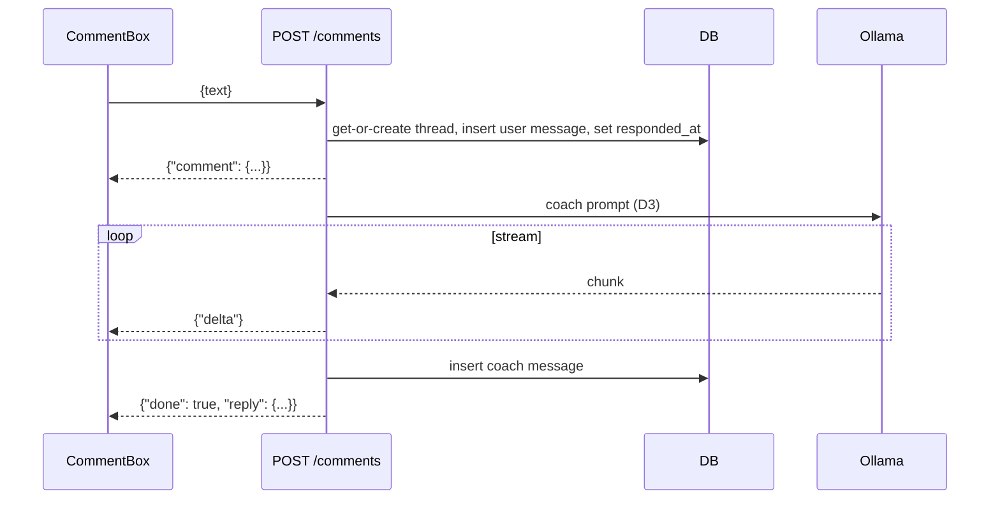

# Design — card-comments

## Context

- `conversations(id, title, book_id, seed_kind, seed_ref, …)` and
  `messages(id, conversation_id, role, text, created_at)` exist
  (`lifekit/db/schema.py`).
- `post_message` in `lifekit/serve/server.py` streams SSE events
  `{"delta"}`, then `{"done": true, "reply"}`, or `{"error"}`. The frontend hook
  `useConversation.ts` reads them.
- feed-v1 provides `card_state.responded_at`, `FeedCardView` with a thread
  slot, and `CardContext`.
- card-types-v1 provides `spec(type).comment_hint` and
  `spec(type).coach_instruction`.
- book-model-v1 provides `passages(id, book_id, section_id, ord, text, …)` and
  `passages_fts`.

## Goals / Non-Goals

**Goals:**
- A comment is saved before anything else happens, and nothing deletes it.
- Every comment gets a grounded reply that fits it.
- The thread reads like a comment thread, not a chat window.

**Non-Goals:**
- No posts without a card (the "+" button, v2, ROADMAP D13).
- No reply that is only a reaction (v2, ROADMAP D4).
- No editing or deleting of comments in v1.
- No reactions on the user's own comments.

## Decisions

### D1. Migration

```sql
ALTER TABLE conversations ADD COLUMN card_id TEXT;
CREATE UNIQUE INDEX IF NOT EXISTS conversations_card ON conversations(card_id)
    WHERE card_id IS NOT NULL;
ALTER TABLE messages ADD COLUMN reaction TEXT
    CHECK(reaction IN ('like','dislike'));
```

`init_db()` adds each column only when `PRAGMA table_info` lacks it, as the
existing migrations do. A card thread uses `seed_kind = 'card'`,
`seed_ref = card_id`, the card's `book_id`, and the card title as its title.
The existing CHECK on `seed_kind` already allows `'card'`.

Get-or-create: `INSERT OR IGNORE` on the unique index, then `SELECT`. Two
quick posts on a new card cannot make two threads.

### D2. Post flow



- The first SSE event carries the stored user comment with its id, so the UI
  swaps its pending bubble for the stored one.
- On a model failure, the server sends `{"error": "The coach could not
  reply."}` and stores nothing more. The user comment stays.
- `POST /api/cards/<id>/comments/retry` finds the last user message with no
  coach message after it, builds the same prompt, and streams the same events
  without the first one. With no such message, it returns HTTP 409.
- Text is trimmed. Empty text returns HTTP 400. Text longer than 8,000
  characters returns HTTP 413 (a journal entry fits; a pasted chapter does
  not).

### D3. Coach prompt and grounding (`lifekit/serve/coach.py`)

`build_messages(c, card_id, thread_id) -> list[dict]`:

1. System: `OPENUI_SYSTEM_PROMPT`, then the coach rules, then the type's
   `coach_instruction`, then the context block.
2. Coach rules (fixed text):
   - Reply to every comment.
   - Match the comment: for a journal entry or a check-in, a few warm words
     about what the user wrote and at most one question; for a direct
     question, a real answer.
   - Use only the context. Quote the book with `Quote` when it helps.
   - Never grade the user. On a question card, compare with the author's
     answer without saying right or wrong.
3. Context block, in order:
   - The card: type, title, content JSON, quote.
   - The card's passage and the passages at `ord ± 1` in the same section.
     When `passage_id` no longer exists, use the quote only.
   - The top 3 `passages_fts` hits for the latest user comment, in the card's
     book, minus passages already listed.
4. The thread history, oldest first, read **after** the user message is stored.
   No message is appended a second time.

The context block is capped at 6,000 characters; the FTS hits are cut first.

### D4. Reactions on coach replies

`PUT /api/messages/<id>/reaction {value}` with `like`, `dislike`, or null. It
updates `messages.reaction` where `role = 'coach'`. A user message returns HTTP
400; an unknown id, HTTP 404. It adds no `card_events` row. The dogfood check
counts disliked replies straight from `messages`.

### D5. Feed entry delta

feed-v1's entry gains:
- `comment_count`: user and coach messages in the card's thread.
- `recent`: the last 2 messages, each `{id, role, text, reaction,
  created_at}`, oldest first.
- `answered`: true when the thread holds a user message.

One query per page joins the threads and uses a window function to pick the
last 2 messages per thread.

### D6. Frontend

- `useComments(cardId, initial)`: holds the thread. `expand()` loads the whole
  thread with `GET`. `post(text)` adds a pending user bubble, reads the SSE
  stream, and fills a coach bubble from the deltas. `retry()` and
  `react(messageId, value)` work the same way.
- `CommentThread`: shows `recent`; "View all N comments" expands in place.
  User comments render with `react-markdown`, `remark-gfm`, and the `lk-prose`
  class, as `MessageList.tsx` does today. Coach replies render with the OpenUI
  `Renderer` and the chat library. A streaming reply shows "Coach is writing…"
  until the first delta. A failed reply shows "The coach could not reply." and
  a Retry button. Each coach reply has like and dislike, the same
  `ReactionBar` as cards.
- `CommentBox`: a `textarea` that grows to about 12 lines, then scrolls. The
  placeholder is the card's `comment_hint`. Post is disabled while empty or
  while a reply streams. Ctrl/Cmd+Enter posts. The text stays in the box until
  the server confirms the stored comment.
- `FeedCardView` sets `CardContext.answered` from the thread, so the question
  card's `AuthorAnswer` opens after the first comment without a reload.

The old chat had a bug that showed a reply twice while streaming (fixed in
commits `52ffe1c` and `dba5644` on the abandoned branch). `useComments` keeps
one coach bubble per stream and replaces it with the stored reply on `done`.
A test covers it (tasks 2.3).

### D7. Removals

Remove `_retrieve_passages`, `_search_chapters`, and `_coach_messages` from
`server.py`; the chat routes call `coach.build_messages` with no card until
retire-free-chat deletes them. Remove the `python -m lifekit.store` ingest
path and its `book_chunks` writer; point the Makefile `ingest` target at
`lifekit ingest`.

## Risks / Trade-offs

- [A reply on every comment costs one model call and some waiting] → Accepted
  (ROADMAP D4). Measured by dislikes on replies.
- [A short "Done!" check-in gets a long reply] → The coach rules ask the reply
  to match the comment. Tune the rules in dogfood; no code change.
- [The home GPU is off] → Comments still save; replies fail with Retry.
- [The context block grows with long threads] → The 6,000-character cap
  applies to the context, not the history. Revisit if threads get long.

## Migration Plan

1. Land the migration, the routes, the coach module, and the frontend in one
   commit with the removals.
2. On the workstation, `init_db()` runs on start and adds the columns.
3. Rollback: revert the commit. The new columns can stay.

## Open Questions

None.
