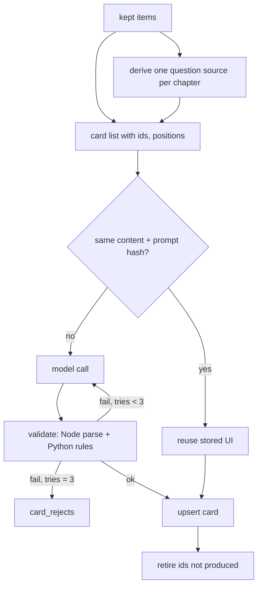

# Design — card-generation

## Context

See proposal.md → Why. Current OpenUI use:

- `frontend/src/lib/openui.tsx`: one library (`Card` root, `TextContent`,
  four charts) for chat replies.
- `frontend/scripts/gen_openui_prompt.ts`: imports that library and writes
  `library.prompt()` into `lifekit/serve/openui_prompt.py`
  (`OPENUI_SYSTEM_PROMPT`). The command that runs it is not documented
  anywhere (commit `6c61732` adds it without one).
- `@openuidev/react-lang` 1.2.0 exports `defineAction`, `useTriggerAction`,
  `useStateField`, `createParser`, `buildMessage`/`parseMessage`, and Renderer
  props `onAction`, `onStateUpdate`, `initialState` (checked in the 1.2.0
  package `dist/index.d.mts`). The frontend pins `^1.1.1`.
- Custom actions do not run in the renderer. They reach the host's `onAction`
  as `{type: "<Name>", params, formState}` (openui.com docs, "Actions").
- Parser: `createParser(library.toJSONSchema(), library.root).parse(text)`;
  errors land in `result.meta.errors` with codes such as `unknown-component`,
  `missing-required`, `type-mismatch`, `no-root`.

## Goals / Non-Goals

**Goals:**
- The model decides the layout and wording of each card and surface; code
  decides the facts, the ids, and the checks.
- Nothing invalid reaches the feed.

**Non-Goals:**
- No generation at view time.
- No user-editable cards.
- No persistence of surface state (card-activity-drawer).

## Decisions

### D1. Two programs from one model call

For each card, one `chat_json_schema` call returns
`{"card_ui": "<OpenUI Lang>", "surface_ui": "<OpenUI Lang>"}`. The system
prompt holds:
1. The card library prompt and the surface library prompt (generated, D5).
2. Rules: use only the content given; do not add facts; the feed card has one
   OpenButton with `@OpenActivity()` and its label is a short verb phrase
   ("Try it", "Start tracking", "Write", "Fill in", "Answer", "Think about
   it"); put the SourceLabel and the Quote on the feed card; keep the feed card
   under 90 words.
3. The type's `surface` text from `card_types.toml`, which names the required
   parts (spec: "Required parts per card type").

The user message holds the card type, title, source label, quote, and content
JSON.

Alternative: two calls (card, then surface). Rejected: twice the calls for the
same context. Alternative: code templates with the model filling text slots.
Rejected: the user asked for generative UI, and the parser gate already makes
the model's output safe.

### D2. Validation split between Node and Python

The OpenUI parser is JavaScript only. Python owns the card-type rules, so the
rules stay next to `card_types.toml`.

- `frontend/scripts/validate_openui.mjs`: plain JavaScript (no JSX, no
  TypeScript), so `node` runs it with no build step. It loads the card and
  surface JSON schemas from `lifekit/cards/openui_schemas.json` (D5), reads one
  JSON request per line on stdin (`{"id", "library": "card"|"surface",
  "program"}`), parses with `createParser(schema, root)`, and writes one JSON
  line per request: `{"id", "errors": [...], "nodes": [{"component", "props"}]}`
  where `nodes` is the element tree flattened in document order.
- `lifekit/cards/validate.py`: starts the Node process once per stage run,
  sends requests, and checks `errors == []`, the root, and the type rules on
  `nodes`: one `OpenButton` with an `OpenActivity` action in the card; the
  surface parts per type; Checklist items equal to the content steps; one input
  per worksheet field id; `Reveal.requires == "answer"`.

### D3. Card id and item link

`card_id = uuid5(LIFEKIT_NS, f"{book_id}|{card_type}|{normalize_ws(quote).lower()}")`
with a fixed namespace UUID constant in `lifekit/cards/generate.py`. A derived
question card uses card type `question` and the quote of its source item, so
its id is distinct from the source insight's id.

`cards.item_key` stores the item key (item-extraction-v2 D8). Item rows are
replaced on every items run, so the link uses the key, not the item id.

Two items with the same id (same type and quote) after consolidation: keep the
one with the lower position and count the other as a collision in the summary.

### D4. Tables

```sql
CREATE TABLE IF NOT EXISTS cards (
    id TEXT PRIMARY KEY,                 -- uuid5, D3
    book_id TEXT NOT NULL REFERENCES books(id),
    item_key TEXT NOT NULL,
    type TEXT NOT NULL,
    stance TEXT NOT NULL,
    title TEXT NOT NULL,
    quote TEXT NOT NULL,
    passage_id TEXT,                     -- may dangle after re-ingest; display falls back to quote
    section_idx INTEGER NOT NULL,
    position INTEGER NOT NULL,
    content TEXT NOT NULL,               -- JSON, card-type content
    card_ui TEXT NOT NULL,
    surface_ui TEXT NOT NULL,
    content_hash TEXT NOT NULL,          -- sha256(content + title + quote)
    prompt_hash TEXT NOT NULL,
    run_id TEXT NOT NULL REFERENCES runs(id),
    retired_at TIMESTAMP,
    created_at TIMESTAMP DEFAULT CURRENT_TIMESTAMP,
    updated_at TIMESTAMP DEFAULT CURRENT_TIMESTAMP
);
CREATE INDEX IF NOT EXISTS cards_feed ON cards(book_id, retired_at, position);

CREATE TABLE IF NOT EXISTS card_rejects (
    id INTEGER PRIMARY KEY AUTOINCREMENT,
    book_id TEXT NOT NULL,
    item_key TEXT NOT NULL,
    run_id TEXT NOT NULL REFERENCES runs(id),
    errors TEXT NOT NULL,                -- JSON list from the last attempt
    created_at TIMESTAMP DEFAULT CURRENT_TIMESTAMP
);
```

Upsert by `id`. After a run, set `retired_at = now` for the book's cards whose
id the run did not produce, and set `retired_at = NULL` for every id it did
produce. User state lives in other tables keyed by card id (feed-v1,
card-activity-drawer), so it survives both.

Reuse rule: when a card id exists with the same `content_hash` and
`prompt_hash` and the run is not forced, keep the stored `card_ui` and
`surface_ui` and make no call. `prompt_hash` covers the system prompt and both
library prompts, so a component change regenerates every card.

### D5. Libraries and generated artifacts

Files:
- `frontend/src/lib/openuiShared.tsx`: `TextContent` and `Quote`, shared by
  the libraries (moved out of `openui.tsx`, which keeps the chat library).
- `frontend/src/lib/cardLibrary.tsx`: `FeedCard`, `SourceLabel`, `OpenButton`,
  action `OpenActivity` (no params).
- `frontend/src/lib/surfaceLibrary.tsx`: `Surface`, `Checklist`, `TextArea`,
  `Scale`, `Choice`, `CheckIn`, `Reveal`, `AskCoach`, `DoneButton`, actions
  `MarkDone` and `CheckIn` (no params). Inputs use `useStateField(name)` so
  their values reach `onStateUpdate` and come back through `initialState`.
  `AskCoach(prompt)` uses the built-in `@ToAssistant(prompt)`; the drawer
  routes that event into the card's conversation. `Reveal` sets the state field
  `revealed`.

`gen_openui_prompt.ts` writes:
- `lifekit/serve/openui_prompt.py` (chat, as today),
- `lifekit/cards/openui_prompts.py` (`CARD_PROMPT`, `SURFACE_PROMPT`),
- `lifekit/cards/openui_schemas.json` (`library.toJSONSchema()` and `root` for
  card and surface).

All three are generated and committed; a test fails when they are older than
the library sources (it compares a hash of the source files written into each
artifact's header).

### D6. Stage flow



Question cards need content too: the call for a derived question returns
`{"question", "author_answer", "card_ui", "surface_ui"}`. `author_answer` must
restate the source item's body or rule in at most 60 words; the quote stays the
source item's quote.

Positions: the stage sorts the produced cards by item position, with each
chapter's question card after that chapter's last card, and numbers them 1..N.
So positions are unique among a book's active cards, and the feed can page by
position alone.

## Risks / Trade-offs

- [The 27B model writes invalid OpenUI often] → Retries with parser errors
  usually fix syntax. If rejections pass 10% of cards (ASSUMPTIONS A27), stop
  and simplify the libraries before dogfood.
- [Generated feed cards look different from each other] → That is the point of
  generative UI, but the FeedCard root fixes the frame, padding, and type badge
  in code, so the feed still looks like one product.
- [Node must be on the machine that runs ingest] → The workstation already runs
  the Next.js build. The stage fails fast with "node not found" if it is absent.
- [Generated artifacts drift from the library source] → The staleness test in D5.

## Migration Plan

1. Land libraries, artifacts, validator, tables, and stage.
2. Workstation: `lifekit ingest --book dyl --from cards`.
3. Rollback: drop `cards` and `card_rejects`; nothing outside the feed reads them.

## Open Questions

- Exact OpenButton labels per type. They live in the prompt and can change
  without changing the spec.
