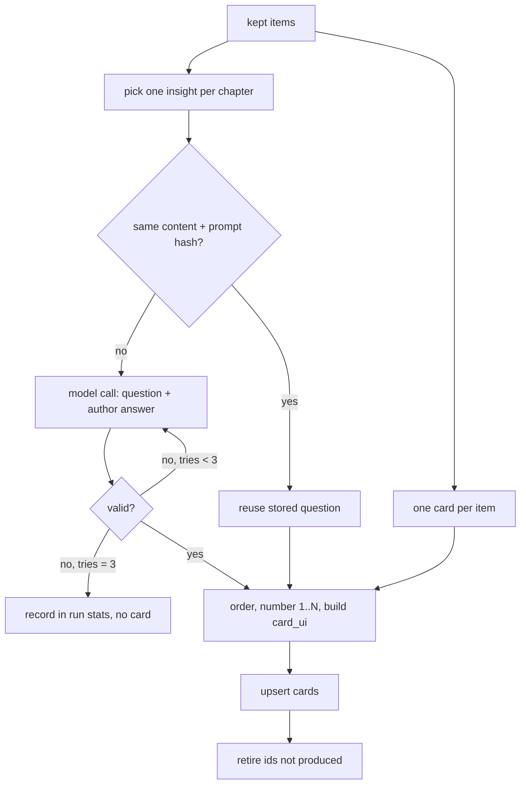

# Design — card-generation

## Context

See proposal.md → Why. Current OpenUI use:

- `frontend/src/lib/openui.tsx`: one library (`Card` root, `TextContent`,
  four charts) for chat replies. `TextContent` renders markdown with
  `react-markdown`.
- `frontend/scripts/gen_openui_prompt.ts`: imports that library and writes
  `library.prompt()` into `lifekit/serve/openui_prompt.py`
  (`OPENUI_SYSTEM_PROMPT`). The command that runs it is not documented
  anywhere (commit `6c61732` adds it without one).
- OpenUI Lang syntax (from that generated prompt): one `name = Expression` per
  line, `root = <Root>(...)`, positional arguments, strings in double quotes
  with backslash escapes.
- The frontend pins `@openuidev/react-lang` `^1.1.1`. Version 1.2.0 exports
  `createParser` (checked in its `dist/index.d.mts`).
- Parser: `createParser(library.toJSONSchema(), library.root).parse(text)`;
  errors land in `result.meta.errors` with codes such as `unknown-component`,
  `missing-required`, `type-mismatch`, `no-root`.

## Goals / Non-Goals

**Goals:**
- Every card renders through OpenUI from a stored program.
- Code decides the facts, the ids, the order, and (in v1) the layout.
- Nothing invalid reaches the feed.

**Non-Goals:**
- No model-written card UI (v3, ROADMAP D6).
- No buttons or actions in card programs. Reactions and comments are drawn by
  code outside the program (feed-v1, card-comments).
- No generation at view time.

## Decisions

### D1. Layouts per type in Python

`lifekit/cards/render.py` has one function per card type that returns an
OpenUI Lang program. Every string goes through `lit(s) = json.dumps(s,
ensure_ascii=False)`, which gives a double-quoted literal with backslash
escapes, as the syntax needs.

| Type | Program children, in order |
|------|----------------------------|
| insight | `SourceLabel`, `TextContent(title, "large-heavy")`, `TextContent(body)`, `TextContent("Why it matters: " + why_it_matters, "small")`, `Quote` |
| practice | `SourceLabel`, title, `TextContent(purpose)`, `Steps(steps)`, `Quote` |
| habit | `SourceLabel`, title, `TextContent(behavior)`, `TextContent("Daily" or "Weekly", "small")`, `TextContent("Start: " + how_to_start)`, `Quote` |
| reflect | `SourceLabel`, `TextContent(prompt, "large")`, one `TextContent` per follow-up, `Quote` |
| question | `SourceLabel`, `TextContent(question, "large")`, `AuthorAnswer(author_answer, quote, locator)` |

Example output for a practice card:

```text
root = FeedCard("practice", [src, title, purpose, steps, quote])
src = SourceLabel("From the book", "Chapter 2 · Building a Compass")
title = TextContent("Write your Workview", "large-heavy")
purpose = TextContent("Know what work means to you.")
steps = Steps(["Set a 30-minute timer.", "Write about 250 words on why you work."])
quote = Quote("Write a short reflection on your view of work…", "p. 41")
```

Alternative: build the program in the frontend from the content JSON at render
time. Rejected: then v3 would add a second path (stored programs next to
built ones). Storing the program from day one keeps one path.

### D2. Parser check in tests only

- `frontend/scripts/validate_openui.mjs`: plain JavaScript, so `node` runs it
  with no build step. It loads `lifekit/cards/openui_card_schema.json` (D4),
  reads one JSON request per line on stdin (`{"id", "program"}`), parses with
  `createParser(schema, root)`, and writes one JSON line per request:
  `{"id", "errors": [...]}`.
- `tests/test_card_render.py` renders one sample card of every type, plus
  samples with quotes, backslashes, newlines, and non-ASCII text, and checks
  that every program parses with `errors == []`. The test skips when `node` is
  absent.

The layouts are fixed code, so a passing test covers every card the stage can
make. The stage itself does not call Node.

### D3. Card id and item link

`card_id = uuid5(LIFEKIT_NS, f"{book_id}|{card_type}|{normalize_ws(quote).lower()}")`
with a fixed namespace UUID constant in `lifekit/cards/generate.py`. A derived
question card uses card type `question` and the quote of its source item, so
its id is distinct from the source insight's id.

`cards.item_key` stores the item key (item-extraction-v2 D8). Item rows are
replaced on every items run, so the link uses the key, not the item id.

Two items with the same id (same type and quote) after consolidation: keep the
one with the lower position and count the other as a collision in the summary.

### D4. Libraries and generated artifact

- `frontend/src/lib/openuiShared.tsx`: `TextContent` (moved out of
  `openui.tsx`) and `Quote(text, locator)`.
- `frontend/src/lib/cardLibrary.tsx`: `FeedCard(type, children)` (root; code
  fixes the frame, padding, and type badge), `SourceLabel(label, locator)`,
  `Steps(items)` (numbered list), `AuthorAnswer(text, quote, locator)`.
- `AuthorAnswer` reads a React context `CardContext` with `{answered:
  boolean}` that the host (feed-v1) provides around the renderer. While
  `answered` is false it shows "Post your answer to see the author's answer."
  When true it shows the answer and the quote, with no right or wrong mark.
- The chat library adds `Quote`, so a coach reply can quote the book in the
  same style as a card.

`gen_openui_prompt.ts` writes `lifekit/serve/openui_prompt.py` (chat, as
today) and `lifekit/cards/openui_card_schema.json` (`toJSONSchema()` and `root`
of the card library), each with a header that holds a hash of the library
source files. A test fails when a header hash does not match the sources. No
card prompt is generated, because no model writes cards in v1.

### D5. Question cards

For each top-level body section, pick the kept insight item with the highest
usefulness rating (ties: lower position). One `chat_json_schema` call with the
`QuestionContent` schema returns `{"question", "author_answer"}`. The prompt
says: ask one question that a reader who understood the item can answer in a
few sentences; `author_answer` restates the item's body or rule in at most 60
words; use only the item's text and quote.

Validation is `validate_card("question", …)`. On failure, retry at most twice
with the errors in the prompt. After that, the chapter gets no question card,
and `runs.stats.question_failures` lists `{item_key, errors}`.

Reuse: when a stored question card has the same `content_hash` (of the source
item's content, title, and quote) and `prompt_hash`, and the run is not forced,
keep the stored question and make no call.

### D6. Table

```sql
CREATE TABLE IF NOT EXISTS cards (
    id TEXT PRIMARY KEY,                 -- uuid5, D3
    book_id TEXT NOT NULL REFERENCES books(id),
    item_key TEXT NOT NULL,
    type TEXT NOT NULL,
    stance TEXT NOT NULL,
    title TEXT NOT NULL,
    quote TEXT NOT NULL,
    passage_id TEXT,                     -- may dangle after re-ingest; display falls back to quote
    section_idx INTEGER NOT NULL,
    position INTEGER NOT NULL,
    content TEXT NOT NULL,               -- JSON, card-type content
    card_ui TEXT NOT NULL,               -- OpenUI Lang, D1
    content_hash TEXT NOT NULL,          -- sha256(source content + title + quote)
    prompt_hash TEXT,                    -- question cards only
    run_id TEXT NOT NULL REFERENCES runs(id),
    retired_at TIMESTAMP,
    created_at TIMESTAMP DEFAULT CURRENT_TIMESTAMP,
    updated_at TIMESTAMP DEFAULT CURRENT_TIMESTAMP
);
CREATE INDEX IF NOT EXISTS cards_feed ON cards(book_id, retired_at, position);
```

Upsert by `id`. After a run, set `retired_at = now` for the book's cards whose
id the run did not produce, and set `retired_at = NULL` for every id it did
produce. User state lives in other tables keyed by card id (feed-v1,
card-comments), so it survives both.

### D7. Stage flow



Positions: the stage sorts the produced cards by item position, with each
chapter's question card after that chapter's last card, and numbers them 1..N.
So positions are unique among a book's active cards, and the feed can page by
position alone.

## Risks / Trade-offs

- [Code-built layouts look the same from card to card] → Intended for v1. The
  `FeedCard` frame and the type badge carry the visual identity (ROADMAP D15).
  v3 lets the model vary layouts.
- [An OpenUI version change breaks the stored syntax] → The parse test runs on
  every layout; regenerate cards with `--from cards` after a library change.
- [Generated artifacts drift from the library source] → The hash-header test in
  D4.

## Migration Plan

1. Land the libraries, the artifact, the layouts, the table, and the stage.
2. Workstation: `lifekit ingest --book dyl --from cards`.
3. Rollback: drop `cards`; nothing outside the feed reads it.

## Open Questions

None.
