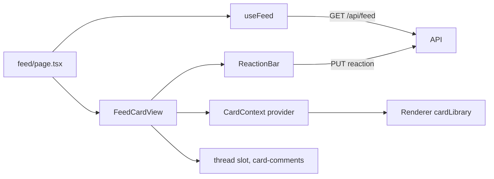

# Design — feed-v1

## Context

- Today: `FeedAPI` in `lifekit/serve/server.py` serves `/api/briefing/today`
  (built by `_briefing`, `_today_exercise`, `_resurfaced_idea`,
  `_fading_ideas`), `/api/completions`, and `/api/idea-signals`. The page
  `frontend/src/app/feed/page.tsx` calls `useBriefing` and renders three fixed
  card components under `TodayHeader`. feed-only-ui (slice 0) already removed
  the sidebar, the chat pages, and the "Talk about this" buttons.
- card-generation provides `cards(id, book_id, type, title, card_ui, position,
  retired_at, …)` with dense positions per book, and the card library with
  `CardContext`.
- card-types-v1 provides `spec(type).comment_hint`.
- ROADMAP D1, D5, and D9 fix the shape: one screen, reactions instead of a
  "Not useful" menu, no done state, and a start point.

## Goals / Non-Goals

**Goals:**
- One list, one order, no hidden ranking.
- The feed opens where the user left off.
- Reactions the dogfood review can count.

**Non-Goals:**
- No comments (card-comments).
- No card status or done state (retired, ROADMAP D9).
- No book switcher. The `book_id` parameter exists for tests and for the
  second book later.

## Decisions

### D1. State tables

```sql
CREATE TABLE IF NOT EXISTS card_state (
    card_id TEXT PRIMARY KEY,            -- cards.id; no FK so state survives a cards rebuild
    reaction TEXT CHECK(reaction IN ('like','dislike')),   -- NULL = none
    responded_at TIMESTAMP,              -- first reaction or comment; NULL = never
    updated_at TIMESTAMP DEFAULT CURRENT_TIMESTAMP
);

CREATE TABLE IF NOT EXISTS card_events (
    id INTEGER PRIMARY KEY AUTOINCREMENT,
    card_id TEXT NOT NULL,
    kind TEXT NOT NULL CHECK(kind IN ('reaction')),
    value TEXT,                          -- like | dislike | NULL
    created_at TIMESTAMP DEFAULT CURRENT_TIMESTAMP
);
```

State is separate from `cards` because the cards stage rewrites card rows; a
pipeline run must never touch the user's state. A missing row means no
reaction and never responded. No foreign key, because a card can be retired
and later come back with the same id (card-generation D6).

`card_events` exists for the dogfood review only. The active-days measure is
the distinct dates in `card_events.created_at` plus the dates of the user's
comments (card-comments).

### D2. Feed queries

Active cards: `c.book_id = ? AND c.retired_at IS NULL AND COALESCE(s.reaction,
'') != 'dislike'`, joined `cards c LEFT JOIN card_state s ON s.card_id = c.id`.

| Request | Rows |
|---------|------|
| no cursor | Start position `p0` = the highest position among active cards with `responded_at` set, or the lowest active position if none. Return active cards with `position >= p0`, ascending, limit 21. |
| `after=P` | Active cards with `position > P`, ascending, limit 21. |
| `before=P` | Active cards with `position < P`, descending, limit 20, then reversed. |

The 21st row only tells the server that a next page exists. `next_cursor` is
the last returned position, or null. `prev_cursor` is the first returned
position if any active card sorts before it, or null. `total` is the count of
active cards.

The start point uses the **furthest** card the user responded to, not the most
recent one. So going back to comment on an early card does not move the start
point back.

Default book: `SELECT book_id FROM cards GROUP BY book_id ORDER BY
MAX(updated_at) DESC LIMIT 1`. `FeedAPI(book_id=…)` still pins a book when
given; otherwise each request resolves it.

### D3. Endpoints

| Method | Path | Body | Result |
|--------|------|------|--------|
| GET | `/api/feed?book_id=&after=&before=` | – | `{book: {id, title} \| null, total, cards: [...], prev_cursor, next_cursor}` |
| PUT | `/api/cards/<id>/reaction` | `{value: "like" \| "dislike" \| null}` | `{reaction}`; 404 unknown card; 400 bad value |

A feed entry is `{id, type, title, card_ui, position, reaction, comment_hint}`.

The reaction write runs in one transaction: upsert `card_state` (set
`reaction`, set `responded_at` if it is NULL), and insert a `card_events` row.
The code lives in `lifekit/serve/feed.py` as plain functions taking a
connection; `server.py` only wires routes, like the conversation routes do.

### D4. Frontend



- `useFeed(bookId?)`: loads the start page, exposes `cards`, `total`,
  `loadMore`, `loadEarlier`, and `react(id, value)`. `react` updates the card at
  once and restores the old value if the request fails. `loadMore` runs when a
  sentinel element near the end becomes visible (IntersectionObserver).
  `loadEarlier` runs from the "Show earlier cards" button and keeps the scroll
  position steady by measuring the height added above.
- `FeedCardView`: wraps the `Renderer` for `card_ui` in `CardContext` with
  `answered: false` (card-comments sets the real value), then the
  `ReactionBar`, then a slot for the thread. A disliked card renders as one
  line: "Marked not useful · Undo". Undo sends `value: null`.
- `ReactionBar`: two icon buttons, like and dislike, with `aria-pressed`. One
  tap sets; a second tap on the same button clears. Pressed state pairs color
  with a filled icon (ROADMAP D15).
- Layout: one centered column, `max-width` about 40rem, on every screen width.
  The header holds the book title, "142 cards", and the existing
  `ThemeToggle` (it moves out of the deleted `TodayHeader.tsx`).

### D5. Removals

Delete in `server.py`: the three routes and `_today_exercise`,
`_exercise_dict`, `_resurfaced_idea`, `_fading_ideas`, `_briefing`. Keep
`_book_info`. Delete the four feed components and `useBriefing.ts`. The tables `completions`, `idea_signals`, `fsrs_cards`, `exercises`,
and `key_ideas` stay in the schema with no readers; a later cleanup drops them
after dogfood.

## Risks / Trade-offs

- [200+ cards for one book is a long list] → Paging and the start point keep
  each visit short. A book-order list is the honest baseline for dogfood.
- [Cards the user scrolled past without a response sit above the start point]
  → "Show earlier cards" reaches them. Accepted for v1 (ROADMAP D9).
- [A page of 20 renderers is slow on the phone] → Measure before changing
  anything.
- [Deleting the briefing loses the scheduler path] → Intended: scheduling is
  parked. The code stays in git history.

## Migration Plan

1. Add tables, endpoints, and the new page in one commit with the removals.
2. On the workstation, run the cards stage first (card-generation), then
   `lifekit ui`.
3. Rollback: revert the commit. `card_state` and `card_events` can stay.

## Open Questions

None.
