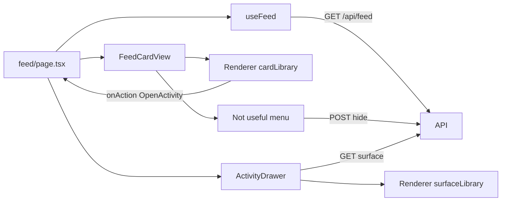

# Design — feed-v1

## Context

- Today: `FeedAPI` in `lifekit/serve/server.py` serves `/api/briefing/today`
  (built by `_briefing`, `_today_exercise`, `_resurfaced_idea`,
  `_fading_ideas`), `/api/completions`, and `/api/idea-signals`. The page
  `frontend/src/app/feed/page.tsx` calls `useBriefing` and renders three fixed
  card components plus `MasterComposer`.
- `origin/feat/card-first-feed` changes seven files. The parts worth keeping:
  the two-pane layout in `feed/page.tsx` and `layout.tsx`, the
  `ActivityDrawer.tsx` shell (header, close button, embedded `ChatView`), the
  `useConversation.ts` changes that let `ChatView` take a conversation id, and
  the one-line `openui_prompt.py` fix. Its drawer keys cards as
  `{kind, id: number}` and creates a new conversation on every open; both go.
- card-generation provides `cards(id, book_id, type, title, card_ui,
  surface_ui, position, retired_at, …)` with dense positions per book.
- card-types-v1 provides `next_status(current, target, previous=None)` in
  `lifekit/cards/types.py` and the statuses `new`, `opened`, `in_progress`,
  `done`, `hidden`.

## Goals / Non-Goals

**Goals:**
- One list, one order, no hidden ranking.
- A "Not useful" signal the dogfood review can count.

**Non-Goals:**
- No saved surface state, no card-linked chat, no status changes on open
  (card-activity-drawer).
- No book switcher. The `book_id` parameter exists for tests and for the
  second book later.

## Decisions

### D1. State tables

```sql
CREATE TABLE IF NOT EXISTS card_state (
    card_id TEXT PRIMARY KEY,            -- cards.id; no FK so state survives a cards rebuild
    status TEXT NOT NULL DEFAULT 'new'
        CHECK(status IN ('new','opened','in_progress','done','hidden')),
    prev_status TEXT,
    updated_at TIMESTAMP DEFAULT CURRENT_TIMESTAMP
);

CREATE TABLE IF NOT EXISTS card_events (
    id INTEGER PRIMARY KEY AUTOINCREMENT,
    card_id TEXT NOT NULL,
    kind TEXT NOT NULL,                  -- not_useful | not_useful_undone | opened | checkin | done
    payload TEXT,                        -- JSON or NULL
    created_at TIMESTAMP DEFAULT CURRENT_TIMESTAMP
);
CREATE INDEX IF NOT EXISTS card_events_card ON card_events(card_id, created_at);
```

State is separate from `cards` because the cards stage rewrites card rows; the
user's state must never be touched by a pipeline run. A missing row means
`new`. No foreign key, because a card can be retired and later come back with
the same id (card-generation D4).

### D2. Feed query

```sql
SELECT c.id, c.type, c.title, c.card_ui, c.position,
       COALESCE(s.status, 'new') AS status
FROM cards c LEFT JOIN card_state s ON s.card_id = c.id
WHERE c.book_id = ? AND c.retired_at IS NULL
  AND COALESCE(s.status, 'new') NOT IN ('hidden', 'done')
  AND c.position > ?
ORDER BY c.position
LIMIT 21;
```

The 21st row only tells the server that another page exists. `next_cursor` is
the 20th card's position. The response also holds `total` (the same query
without cursor and limit, as `COUNT(*)`), which the header shows.

Default book: `SELECT book_id FROM cards GROUP BY book_id ORDER BY
MAX(updated_at) DESC LIMIT 1`. `FeedAPI(book_id=…)` still pins a book when
given; otherwise each request resolves it.

### D3. Endpoints

| Method | Path | Body | Result |
|--------|------|------|--------|
| GET | `/api/feed?book_id=&cursor=` | – | `{book: {id, title} \| null, total, cards: [...], next_cursor}` |
| GET | `/api/cards/<id>/surface` | – | `{id, type, title, surface_ui}`; 404 if unknown |
| POST | `/api/cards/<id>/hide` | – | `{status: "hidden"}` |
| DELETE | `/api/cards/<id>/hide` | – | `{status: <previous>}`; 409 if not hidden |

Hide and undo run in one transaction: compute the new status with
`next_status`, upsert `card_state` (keep `prev_status`), and insert the event.
The code lives in `lifekit/serve/feed.py` as plain functions taking a
connection; `server.py` only wires routes, like the conversation routes do.

### D4. Frontend



- `useFeed(bookId?)`: loads pages, exposes `cards`, `total`, `loadMore`,
  `hide(id)`, `undo(id)`. `hide` removes the card from the list at once and
  restores it if the request fails. `loadMore` runs when a sentinel element
  near the end of the list becomes visible (IntersectionObserver).
- `FeedCardView`: a wrapper with the code-owned overflow menu ("Not useful")
  and the `Renderer` for `card_ui`. `onAction` checks `event.type ===
  "OpenActivity"` and calls `onOpen(card.id)`. Other events are ignored.
- `ActivityDrawer` takes `cardId`, fetches the surface, and renders it. It
  keeps the branch's header and close button. The embedded chat moves to
  card-activity-drawer, because a chat without a card link is the bug this
  roadmap fixes.
- Mobile: a `matchMedia("(max-width: 767px)")` check switches the drawer to a
  fixed full-screen sheet with a back button. The feed list stays mounted
  under it, so the scroll position is kept.
- The open card id goes in the URL as `?card=<id>` with `router.replace`, so
  the back button on a phone closes the drawer. card-activity-drawer reuses
  this for deep links.
- `MasterComposer` stays on the page as it is (free chat with the coach).

### D5. Removals

Delete in `server.py`: the three routes and `_today_exercise`,
`_exercise_dict`, `_resurfaced_idea`, `_fading_ideas`, `_briefing`. Keep
`_book_info`, `_retrieve_passages`, `_search_chapters`, and `_coach_messages`
(the coach still needs them until card-activity-drawer). Delete the four feed
components and `useBriefing.ts`. The tables `completions`, `idea_signals`,
`fsrs_cards`, `exercises`, and `key_ideas` stay in the schema with no readers;
a later cleanup drops them after dogfood.

## Risks / Trade-offs

- [200+ cards for one book is a long list] → Paging keeps the page light. The
  "Not useful" control and done-hiding shrink it as the user goes. A
  book-order list is the honest baseline for dogfood.
- [Generated card programs render slowly in bulk] → 20 per page. If a page of
  renderers is slow on the phone, measure before changing anything.
- [Deleting the briefing loses the scheduler path] → Intended: roadmap v2
  parks scheduling. The code stays in git history.

## Migration Plan

1. Add tables, endpoints, and the new page in one commit with the removals.
2. On the workstation, run the cards stage first (card-generation), then
   `lifekit ui`.
3. Rollback: revert the commit. `card_state` and `card_events` can stay.

## Open Questions

None.
