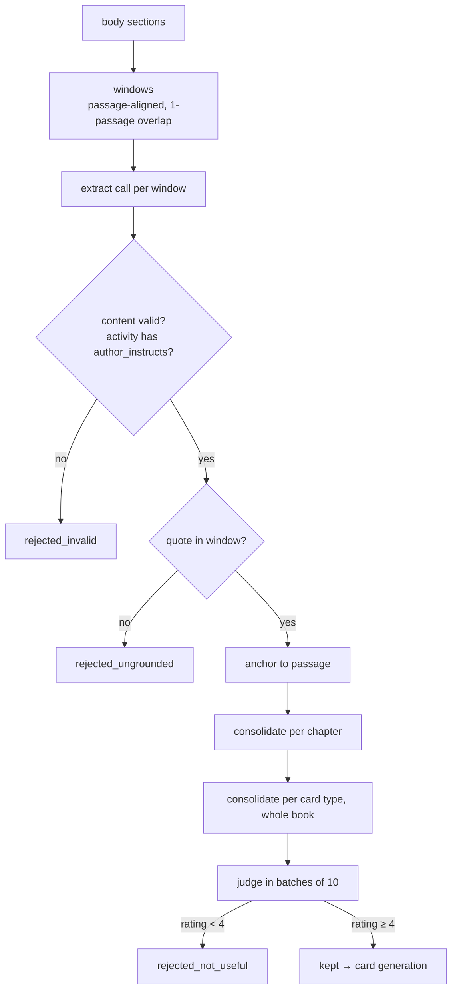

# Design — item-extraction-v2

## Context

See proposal.md → Why. Reused pieces:

- `lifekit/llm/base.py`: `LLMProvider.chat_json_schema(model, messages,
  json_schema, temperature)`. `lifekit/llm/config.py:resolve_config()` picks the
  provider and model.
- `lifekit/extract/extractor.py:_extract_single()`: the retry-on-validation
  loop (3 attempts). Copy the pattern, not the module: the old module stays
  frozen for the old pipeline and its eval.
- `lifekit/validate/validator.py:normalize_ws()`: NFKC plus punctuation folding
  plus whitespace collapse. It took grounding from 10% to 142/144.
- card-types-v1: `card_type_for(kind)`, `content_model(type)`, `validate_card()`.
- book-model-v1: `sections` (kind, depth, parent), `passages`, `runs`,
  `lifekit/ingest.py` stages.

## Goals / Non-Goals

**Goals:**
- Fewer, better items: no front/back matter, no duplicates, no anecdotes.
- Every rejection is stored with a reason, so the eval can explain the numbers.
- All tunable numbers live in one config file.

**Non-Goals:**
- No concept identity across books or a knowledge graph (PoC limit).
- No tags (parked with search).
- No change to the old `exercises` / `key_ideas` pipeline.

## Decisions

### D1. Pipeline per book



### D2. Config file `lifekit/items/items.toml`

```toml
window_chars = 6000        # A22: keep requests small over Tailscale
overlap_passages = 1
max_quote_chars = 300
extract_temperature = 0.1
judge_temperature = 0.0
judge_batch_size = 10
useful_threshold = 4
pace_seconds = 15          # A22: pacing for the home GPU
precision_target = 0.8
min_labels = 30
label_sample = 60
```

### D3. One flat extraction schema, validated per type in code

Ollama's `format=<json schema>` handles flat object lists well. A union of five
content shapes per item is harder for the model. So the window call returns
`{"items": [ItemCandidate]}` where `ItemCandidate` has `kind`, `stance`,
`title`, `quote`, `summary`, and every content field as optional (`body`,
`why_it_matters`, `purpose`, `steps`, `behavior`, `cadence`, `how_to_start`,
`prompt`, `followups`). Code maps
`kind` to the card type, picks that type's fields, and validates them with the
card-types-v1 content model. Failures become `rejected_invalid` with the
Pydantic error text.

The prompt (in `lifekit/items/prompts.py`) states the eight kinds with one
example each from a generic self-help text (not from the dogfood book, to avoid
teaching the eval answers). It says:
- Extract an activity kind only when the author tells the reader to do it.
  Stories, case studies, and examples of what other people did are not
  activities.
- `habit` means the author says to repeat it (daily, each week, every time X).
- `template` means the author gives a form, scale, or set of fields to fill in.
  Write its goal as `purpose` and each field as one step (card-types-v1 D3).
- Do not extract statements about the book itself ("in this chapter…").
- Quote a verbatim sentence or two that best grounds the item.
- Write `summary`, `body`, and steps in plain words a fresh reader understands
  without the chapter.

The prompt text is hashed (SHA-256 of the system prompt plus the JSON schema)
into `runs.prompt_hash`.

### D4. Windows

For each top-level body section, take its own passages plus its descendants'
passages in reading order. Fill a window until adding the next passage would
pass `window_chars`. Start the next window with the last passage of the
previous one. Each window's user message holds the book title, the chapter
title, the subsection titles inside the window, and the window text.

### D5. Anchoring

Build the normalized window text and a map from each normalized character back
to its passage id. Find the normalized quote; the passage at the match start is
the anchor. This handles quotes that span two passages (spec scenario).

### D6. Consolidation calls

Per chapter: send the grounded items as numbered lines
`[n] <card type> | <title> | <summary, ≤ 200 chars>`. Ask for
`{"groups": [{"keep": n, "merge": [n, …], "why": "…"}]}`. Code rules:
- Ignore a group with an unknown number, a number already used in another
  group, or mixed card types.
- `keep` must be a member; if not, keep the earliest member in reading order.

Book level: one call per card type over the chapter-level survivors, same
format and rules. For `insight`, if the list is over 150 lines, split it into
chunks of 150 by reading order and accept that cross-chunk duplicates may
remain.

Alternative: embeddings plus a similarity threshold. Rejected for v1: needs an
embedding model and a threshold to tune; the model call is small and reads
meaning, not word overlap. Alternative: better title normalization. Rejected:
"Odyssey Plans" vs "Three Alternative Lives" have no words in common.

### D7. Usefulness rubric and judge

Rubric (in the judge prompt):

| Rating | Meaning |
|--------|---------|
| 5 | The user can act on it today, or it clearly changes how they see a situation. Specific to this book's method. |
| 4 | Useful and clear on its own, a bit general. |
| 3 | True but generic — could be in any self-help book. |
| 2 | A fragment, a story, or needs the chapter to make sense. |
| 1 | About the book itself, or empty. |

Fail codes: `generic`, `meta`, `story`, `fragment`. The judge sees the item's
title, card type, content, and quote, plus the chapter title. It returns
`{"ratings": [{"n": 1, "rating": 4, "reason": "…", "fail_codes": []}]}` for a
batch of 10. A missing or malformed entry in a batch is retried once alone; if
it fails again the item stays `kept` with reason "judge failed" and is counted
in the summary.

These ratings are pipeline data, like a compiler warning. They never appear in
the UI, so the "no scores" principle (which is about scoring the user) holds.

### D8. `items` table

```sql
CREATE TABLE IF NOT EXISTS items (
    id INTEGER PRIMARY KEY AUTOINCREMENT,
    book_id TEXT NOT NULL REFERENCES books(id),
    run_id TEXT NOT NULL REFERENCES runs(id),
    section_idx INTEGER NOT NULL,          -- top-level body section
    passage_id TEXT REFERENCES passages(id),
    position INTEGER NOT NULL,             -- reading order within the book
    kind TEXT NOT NULL,
    card_type TEXT NOT NULL,
    stance TEXT NOT NULL,
    title TEXT NOT NULL,
    quote TEXT NOT NULL,
    content TEXT NOT NULL,                 -- JSON, card-type content fields
    status TEXT NOT NULL CHECK(status IN ('kept','merged','rejected_invalid',
        'rejected_ungrounded','rejected_not_useful')),
    merged_into INTEGER REFERENCES items(id),
    reason TEXT,
    useful_rating INTEGER,
    fail_codes TEXT,                       -- JSON list
    item_key TEXT NOT NULL                 -- sha1(book|card_type|normalized quote)
);
CREATE INDEX IF NOT EXISTS items_book_status ON items(book_id, status);
```

`position` is `section_idx * 1_000_000 + passage index * 1000 + window order`,
so cards can sort in reading order without joins. A re-run deletes the book's
items before inserting (cards reference items by `item_key`, not by id; see
card-generation D3).

### D9. Golden-set files

```
evals/usefulness/<book_id>/
  labels.jsonl   # {"key","card_type","title","label":"y"|"n","at"}
  report.md      # written by the report command
```

Sampling: group candidates by card type; take `ceil(n / types)` per type with
`random.Random(42)`, then fill the remainder from the largest groups. Status is
not shown while labelling (spec: "hides the judge verdict"). The labels are the
user's data and are committed, like the other eval results.

### D10. Stage wiring

`ItemsStage` in `lifekit/items/stage.py`, registered in `lifekit/ingest.py`
after `structure`. One run record per stage run; the summary from the spec goes
into `runs.stats`. Each model call sleeps `pace_seconds` before the next.

## Risks / Trade-offs

- [The consolidation pass merges two distinct exercises with similar names] →
  The merged item keeps its row with `merged_into` and the model's `why`, so
  the eval report can list merges for review.
- [The judge agrees with itself, not with the user] → That is what the golden
  set measures. A FAIL blocks card generation for dogfood until the rubric or
  prompt changes.
- [60 labels is a small sample] → Enough to tell 0.6 from 0.9. The report warns
  below 30 labels.
- [Long runs over Tailscale fail midway] → The stage stops on failure and the
  run is `failed`; the old items stay until a run succeeds, because deletion
  happens in the same transaction as the insert at the end.

## Migration Plan

1. Land the table and stage. Old tables stay.
2. On the workstation: `lifekit ingest --book dyl --from items`.
3. `lifekit eval usefulness label dyl`, then `lifekit eval usefulness report
   dyl`. Commit `evals/usefulness/dyl/`.
4. Rollback: drop `items`; nothing else reads it until card-generation.

## Open Questions

- Final precision target. 0.8 is proposed in KANBAN → Open questions; the number
  lives in `items.toml`, so it can change without changing this design.
